# 🛡️ VyaparShield AI
### Autonomous Multi-Agent GST Compliance, Document Fraud Shield & Financial Co-Pilot for Micro-Enterprises

-purple?style=for-the-badge)

> **Turning messy WhatsApp bill piles into fraud-checked, pre-audited GST & E-Way bill packets — cutting accountant sorting time by 60%+ while keeping final tax filing strictly human-approved.**

---

## 📌 The Problem (Track 3.1)
Micro-enterprises just above the GST threshold (traders, small manufacturers, transporters, and service businesses) lose **8–12% of annual profits** and **15–20 hours every month** dealing with manual compliance paperwork:
- **Fragmented Workflow:** Paper bills pile up in plastic bags or unorganized WhatsApp chats until month-end, costing ₹1,500–₹3,000 per filing.
- **Lost Input Tax Credit (ITC):** Owners only discover a supplier failed to file GSTR-1 *after* their tax credit is blocked or a department notice arrives.
- **Zero Document Security:** Confidential invoices are shared over unsecured chats with no duplicate detection, PDF tamper checking, QR/GSTIN verification, or access audit logs.
- **Highway Detentions & Blind Consent:** Last-minute E-Way bill errors stall consignments at checkpoints, and owners blindly share GST portal OTPs without understanding the return filed in their name.

---

## 🤖 Our Solution: The 3-Agent Autonomous Pipeline
**VyaparShield AI** acts as an autonomous compliance and cybersecurity layer between the MSME owner and their Chartered Accountant (CA), orchestrated via **Lyzr Agentic AI**:

### 1. Agent 1 — AI Document Intelligence & `DocumentShield` (WhatsApp & Web)
- **Zero-Friction Capture:** Shopkeepers simply forward invoice photos, PDFs, or voice notes via WhatsApp or Web upload.
- **Vision OCR Extraction:** Extracts supplier GSTIN, HSN codes, line items, and CGST/SGST/IGST splits from crumpled bills.
- **Cybersecurity & Fraud Filter:**
  - Cryptographic hashing (SHA-256) blocks **duplicate invoice payments**.
  - Detects **suspicious PDF edits/tampering** and inconsistent tax math.
  - Scans invoice **QR codes** for phishing/tampering and validates active **GSTIN status**.

### 2. Agent 2 — AI Compliance, ITC Reconciler & Rule-Watch Agent
- **GSTR-2B Reconciliation:** Cross-checks purchase registers against simulated supplier filings to calculate exact **ITC (₹) at risk** and auto-drafts payment-hold reminders.
- **Dynamic Rule-Watch (Citation RAG):** Retrieves official CBIC/GST notifications so every tax-rate or TDS answer cites its exact source and stays accurate as rules change.
- **E-Way Bill Co-Pilot:** Automatically detects consignments >₹50,000 and pre-drafts simulated E-Way bills before dispatch.

### 3. Agent 3 — Pre-Audit Notice Predictor, Security Monitoring & Consent Agent
- **Pre-Audit Simulation:** Runs a pre-filing check to flag HSN/tax-rate errors *before* GST department notices arrive.
- **Vernacular Voice Consent:** Delivers a **30-second Kannada / Hindi / English voice summary** of monthly sales, ITC saved, and net tax payable so the owner genuinely understands their return.
- **Security Monitoring:** Enforces **Role-Based Access Control (RBAC)**, immutable document activity logs, and unusual-access alerts.

### 📊 Unified Business Health Dashboard & Financial Co-Pilot
- **Shopkeeper Mode:** Displays a live **Business Health Score (0–100)**, unresolved security alerts, and an action-taking Financial Co-Pilot (*"Hold ₹6,500 from Supplier X until their GSTR-1 reflects"*).
- **Accountant (CA) Mode:** Delivers a 100% pre-sorted, fraud-checked **JSON/Excel Audit Packet** ready for 1-click review and simulated filing approval.

---

## 🏗️ System Architecture

```mermaid
flowchart LR
    subgraph Input["1. Input Layer (MSME)"]
        WA["WhatsApp Bot / Web Upload<br/>(Bill Photos, PDFs, Voice)"]
    end

    subgraph Security["2. Security Gateway (Python FastAPI)"]
        DS["DocumentShield<br/>SHA-256 Duplicate Check<br/>PDF Tamper Analysis"]
        CF["Cyber Filter<br/>QR Phishing & GSTIN Validator"]
    end

    subgraph Agents["3. Lyzr Multi-Agent Orchestrator"]
        A1["Agent 1: Vision OCR &<br/>Document Intelligence"]
        A2["Agent 2: GSTR-2B ITC Reconciler<br/>+ CBIC Citation RAG<br/>+ E-Way Bill Co-Pilot"]
        A3["Agent 3: Pre-Audit Predictor<br/>+ Vernacular Voice Summary<br/>+ RBAC Activity Logger"]
    end

    subgraph Output["4. Human-in-the-Loop & Simulation"]
        DASH["Business Health Dashboard<br/>& Financial Co-Pilot"]
        CONSENT["Owner 1-Tap OTP Consent<br/>& CA 1-Click Approval"]
        SIM["Simulated GST &<br/>E-Way Bill Portal"]
    end

    WA --> DS --> CF --> A1
    A1 --> A2 --> A3
    A3 --> DASH --> CONSENT --> SIM
```

---

## ⚖️ Strict Legal & Compliance Boundaries
In strict alignment with **Track 3.1 boundaries**:
- **Preparation vs. Filing:** VyaparShield AI **never files tax returns autonomously**. It strictly automates extraction, fraud-checking, reconciliation, and pre-audit preparation.
- **Human-in-the-Loop:** Final submission remains strictly with the business owner or Chartered Accountant via explicit 1-tap OTP consent in a **simulated GST portal** during the hackathon.

---

## 🛠️ Tech Stack
| Layer | Technologies |
| :--- | :--- |
| **AI & Multi-Agent Core** | Lyzr AI Multi-Agent Studio, Google Gemini Vision API, Citation RAG (Vector DB) |
| **Backend & Security** | Python (FastAPI / Flask), SHA-256 Duplicate Hashing, QR/GSTIN Validator, RBAC Audit Logger |
| **Frontend & Dashboard** | React.js, Tailwind CSS (Deployed on Vercel / Cloudflare Pages) |
| **Simulation Layer** | Mock GSTR-1 / GSTR-2B Database, Simulated GST & E-Way Bill Filing API |

---

## 💰 Entrepreneurial Model ("Following the Money")
Cutting **60%+ of manual sorting and mismatch-checking** allows a single part-time accountant to manage **2.5x more MSME clients** without hiring extra staff.
- **Micro-Enterprises (FREE Tier):** Free WhatsApp bill capture, `DocumentShield` fraud alerts, and vernacular voice summaries — driving massive grassroots adoption.
- **Tax Practitioners & CAs (₹999/month Pro SaaS):** Unlimited client workspaces, automated GSTR-2B ITC reconciliation, and 1-click Tally/JSON exports (**15x–30x ROI** by onboarding 10+ extra clients).

---

## 🗺️ Prototype Development Roadmap (Nov 23 – Dec 27, 2026)
- [x] **Round 1 (Nov 20):** System Architecture, Field Validation, Pitch Deck & Repository Blueprint.
- [ ] **Sprint 1 (Nov 23 – Dec 1):** Agent 1 (WhatsApp/Web Vision OCR, SHA-256 Duplicate Shield, QR/GSTIN Fraud Validator) + Lyzr AI Orchestration.
- [ ] **Sprint 2 (Dec 2 – Dec 10):** Agent 2 (Simulated GSTR-2B ITC Reconciler, CBIC RAG, E-Way Bill Co-Pilot) & Agent 3 (Pre-Audit + Vernacular Voice Consent).
- [ ] **Sprint 3 (Dec 11 – Dec 15):** Business Health Dashboard, RBAC Activity Logs, Field Testing with Bengaluru Traders/CAs & Final Demo Video.
- [ ] **Grand Finale (Dec 27 @ Bangalore Palace):** Live Interactive Demo & Jury Pitch.

---

## 👥 Team 404 Minds
| Member | Role | Focus Area |
| :--- | :--- | :--- |
| **Nishanth N** | Cybersecurity & Backend Lead | Agent 1 Fraud Shield (QR/GSTIN/Hash), RBAC Security & Python FastAPI |
| **Rohit Sah** | Design & Pitch Lead | Pitch Deck, UI/UX Wireframes, Branding & Visual Storytelling |
| **Rehan Khan** | Frontend & AI Agents Lead | Business Health Dashboard UI, Lyzr Agent 2/3 & Financial Co-Pilot |
| **Aadarsh Mishra** | Architecture & Strategy Lead | System Architecture, Field Research (Traders/CAs) & Business Model |

---

*Built for the **GAVS Tech4Bharat National Hackathon 2026** (An Initiative of Karnataka Arya Vysya Mahasabha in partnership with RV College of Engineering, JanAI & Lyzr AI).*
